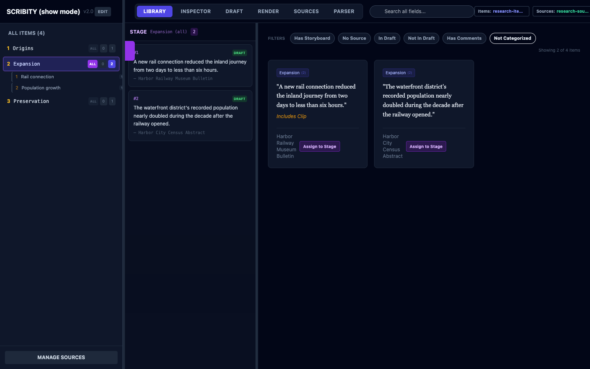

# Scribity

**A local-first research and writing workspace for organizing sources, structuring evidence, and drafting source-backed narratives.**



> **Project status:** Active development. Scribity is usable today, but its interface and document formats may continue to evolve.

Scribity keeps research documents on the user's computer and combines source management, evidence organization, drafting, and import tools in one focused workspace. It supports both general research projects and a specialized rule-and-example workflow originally designed for instructional writing.

## Highlights

- Local JSON documents remain under the user's control.
- Items link directly to structured source records.
- Categories, subparts, tags, filters, and a reorderable Stage help shape large collections of evidence.
- Draft and Render views turn selected material into an ordered narrative.
- An MDX parser previews structured report imports before saving them.
- Optimistic document revisions reject stale saves from old tabs or previously opened files.
- Paired item/source writes use validation, temporary files, and rollback protection.
- Undo history and delayed saves are isolated when switching documents.
- macOS and Windows launchers are included.

## Technology

- Python and Flask for the local server and file operations
- React 18, Tailwind CSS, and Lucide for the browser interface
- Python `unittest` and Playwright for automated regression coverage
- JSON documents for portable, inspectable storage

Scribity is intentionally small and local: there is no account system, hosted database, analytics service, or cloud synchronization layer.

## Quick start

Requirements:

- Python 3.10 or newer
- A current desktop browser
- Node.js only if you want to run the browser tests

```bash
git clone https://github.com/Swampd/scribity.git
cd scribity
python3 -m venv .venv
source .venv/bin/activate
python -m pip install -r requirements.txt
python start_scribity.py
```

On Windows, activate the environment with `.venv\Scripts\activate` and run `python start_scribity.py`. The included `scribity.command` and `scribity.bat` launchers are also available for macOS and Windows.

Scribity opens at [http://localhost:8000](http://localhost:8000). To explore without personal data, use the file controls to open:

- Items: `examples/research-items.json`
- Sources: `examples/research-sources.json`

The `examples/` directory also includes an improv-oriented document pair. Every included example record is synthetic and exists only to demonstrate the interface.

## How documents work

Scribity uses two related JSON arrays:

| Document | Purpose |
| --- | --- |
| Items | Quotations, notes, examples, categories, ordering, and drafting metadata |
| Sources | Bibliographic and reference information linked through `id_source` |

Starter structures are available in `schema_research_items.json`, `schema_improv_items.json`, and `schema_sources.json`. User documents and `scribity_config.json` are ignored by Git so personal research is not committed accidentally.

## Data-safety design

The application treats document integrity as a first-class concern:

1. Loads and saves require arrays of JSON objects.
2. Every active document receives an opaque token and revision.
3. Saves from an old document or stale browser tab are rejected.
4. Delayed edits are flushed before a document switch completes.
5. Operations that update both item and source files stage both writes and roll back if the second commit fails.

These safeguards are covered by server, parser, document-session, accessibility, and browser-interaction tests.

## Testing

Run the Python suite:

```bash
python3 -B -m unittest discover
```

Run the browser suite:

```bash
npm install
npx playwright install chromium
npm run test:e2e
```

The Playwright suite serves the dashboard locally and uses in-memory API responses; it does not open or modify configured research documents. See [TESTING.md](TESTING.md) for details.

## Privacy

Scribity does not upload document contents. File selection, parsing, and saves happen through the local Flask server. The following local files are intentionally excluded from version control:

- `items.json`
- `sources.json`
- `scribity_config.json`
- temporary JSON writes and browser-test output

Before sharing a fork, review its complete Git history as well as its current files; deleting sensitive content in a later commit does not remove it from earlier commits.

## Copyright

Copyright © 2026 Casey Auttonberry. All rights reserved.

No open-source license is granted for Scribity at this time. The source is visible for portfolio and evaluation purposes; see [COPYRIGHT.md](COPYRIGHT.md) for details. Third-party libraries remain subject to their respective licenses.

### Create an episode project from selected research

For the episode-selection workflow, open **Draft → Create project from Draft**.
Your existing Draft is already the selection; you do not need to check cards.
The copied research goes into the new project’s Library, with an empty Draft
ready for a fresh story order. The original project and Draft remain intact.

You can also use **+ → Create project from selection**. Choose the entire current Draft,
checked Library items (including checks hidden by filters), or current filtered
Library results. The dialog describes the scope; Draft selection ignores search,
category, quick filters, and the Draft part filter. Supporting descendants are
always included recursively, even when their `id_script` is zero.

1. Choose **Start with an empty Draft** (default) or **Preserve existing Draft
   order**. Empty resets only `id_script`; preserve retains existing values and
   never adds otherwise undrafted items to Draft.
2. Click **Preview project**. Pending edits are saved first. Review selected,
   additional supporting, total item, and source counts, plus any relationship
   notices. No relevance filtering or narrative reordering is performed.
3. Click **Save new project…** and choose two new JSON filenames. Alternatively,
   enter two absolute paths in existing folders. Neither active originals nor
   other existing files can be overwritten. Canceling either dialog writes
   neither file. A failed paired write rolls back the newly created first file.
4. After both files save, choose **Open new project**, or **Done — keep original
   open**. Opening activates the pair together and saves it as the next-start
   project. Ordinary Save As and rendered script exports are unchanged.

Research fields, IDs, notes, citations, category order, tags, script parts, and
unknown metadata are copied. `nested_under` is the structural support link.
Selected children whose parents are absent become top-level items in the copy;
the original link is recorded in `_scribity_external_references`. Item links in
`related_facts`, `supports`, and `contradicts` that point outside the copy (or are
unresolved) are likewise moved into that provenance list and disclosed in the
preview. Parser-generated `grp_*` multi-citation group labels stay intact; they
do not expand the selection. Generic extra-ID fields and other metadata remain
opaque and unchanged. Warnings must be acknowledged before saving.

Missing referenced source records, conflicting duplicate source IDs, support
cycles, and ambiguous item IDs block extraction with an explanation. Identical
source duplicates are included once. Blank source IDs remain blank. Source
bibliography links and URLs are preserved without pulling in unrelated records.

Previews expire after 30 minutes or a server restart (at most 16 are retained).
Edits, file switches, or external file changes invalidate an unsaved preview;
create a fresh one. Saved files remain available after a preview expires and can
be opened through the ordinary Items/Sources controls. Publication uses atomic
no-overwrite hard links to staged files; a filesystem without hard-link support
will fail safely, in which case save to a local folder that supports them.
